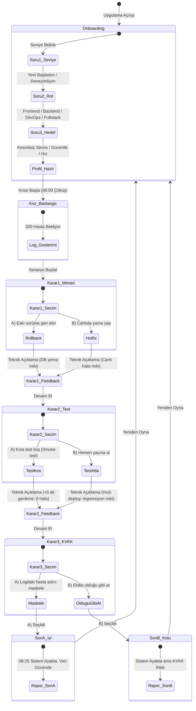

# SE Primer - Sistem Spesifikasyon Dokümanı (`spec.md`)

**Ders:** YZM301 Yazılım Mühendisliği  
**Proje:** SE Primer: Kişiye Uyum Sağlayan İnteraktif Karar ve Öğrenme Simülasyonu  
**Referanslar:** Neal Stephenson (*The Diamond Age*), GitHub *Spec Kit*, Sommerville (*Software Engineering* 10. Baskı, Bölüm 5: Durum Makineleri), KVKK No: 6698.

---

## 1. Problem Tanımı

Geleneksel yazılım mühendisliği eğitiminde öğrenciler; mimari kararlar, test stratejileri ve regülasyon uyumluluğu (KVKK/GDPR) gibi kritik konuları çoğunlukla soyut ve izole teorik bilgiler olarak öğrenirler. Ancak üretim (production) ortamında acil bir kriz anında (örneğin sabah 08:00'de yüzlerce kullanıcının etkilendiği bir kesintide) verilen teknik kararların zincirleme sonuçları (teknik borç, veri tabanı tutarsızlığı, regülasyon cezaları) deneyimlenmeden kavranamaz.

**SE Primer**, yazılım mühendisliği öğrencilerine ve yeni mezunlara kriz anı karar verme süreçlerini interaktif bir vaka üzerinden deneyimleten kişiselleştirilmiş bir pedagojik simülatördür. Oyuncu kritik teknik kararlar verir; sistem her kararın arka planındaki teknik sonucu ("ne oldu ve neden oldu?") anında açıklar. Sistemdeki **Sokratik AI Tutor**, oyuncuya doğrudan cevabı söylemek yerine sorular sorarak doğru mühendislik muhakemesini geliştirmesini sağlar.

---

## 2. Kapsam ve Kapsam Dışı (Scope & Out-of-Scope)

### 2.1. Kapsam İçi (Yapılacaklar)
- **Kişiselleştirilmiş Onboarding:** Oyuncunun seviye (Yeni Başladım / Deneyimliyim), rol (Backend, Frontend, Fullstack, DevOps) ve hedef (Sistem Ayakta Tutma, Güvenlik & Uyum, Hızlı Çözüm) tercihlerini alan 3 soruluk giriş aşaması.
- **Dinamik Anlatı Uyarlaması:**
  - *Yeni Başladım:* Her karar aşamasında Sokratik ipucu paneli otomatik açık gelir, rehberlik odaklı açıklamalar sunulur.
  - *Deneyimliyim:* 60 saniyelik kriz geri sayım süresi baskısı, ayrıntılı log metrikleri ve doğrudan teknik parametreler devrededir.
- **Sağlık Randevu Sistemi Kriz Senaryosu:** 
  - *Başlangıç:* "08:00, randevu sistemi çöktü. Dün gece yeni sürüm çıktı. 300 hasta sırada bekliyor."
- **3 Aşamalı Karar Mekanizması:**
  1. *Karar 1 (Mimari):* A) Eski sürüme geri dön (Rollback) vs. B) Canlıda yama yap (Hotfix in prod)
  2. *Karar 2 (Test):* A) Önce kısa duman/regresyon testi koş vs. B) Hemen yayına al (Direct deploy)
  3. *Karar 3 (KVKK & Güvenlik):* Logda hasta T.C./adı var: A) Maskele (PII Sanitization) vs. B) Ekibe Slack/log kanalından olduğu gibi at
- **Teknik Geri Bildirim ("Ne Oldu, Neden Oldu?"):** Her seçim sonrasında durum makinesinin teknik gerekçeli açıklaması.
- **2 Farklı Nihai Son:**
  - *Son A (İyi Son):* 08:25 Sistem ayakta, veritabanı tutarlı, KVKK güvende.
  - *Son B (Kötü Son):* Sistem ayakta fakat KVKK ihlali ve veri sızıntısı cezası riski.
- **Sokratik AI Tutor:** Kullanıcıya asla doğrudan doğru şıkkı veya çözümü söylemeyen; ipucu, düşündürücü soru ve karşıt argümanlarla yönlendiren yapay zeka rehberi.

### 2.2. Kapsam Dışı (Yapılmayacaklar)
- Kullanıcı kaydı, şifre ile oturum açma (Authentication / Auth0 / Firebase Auth vb.).
- Çoklu bölümlü hikaye akışı (Yalnızca 1 sağlık kriz senaryosu işlenecektir; İkinci bölüm kapsam dışıdır).
- Gerçek hasta veya canlı hastane verileri (Tüm veriler sentetik/sahtedir).
- Native mobil uygulama paketi (iOS/Android IPA/APK geliştirilmeyecek, mobil web olarak tasarlanacaktır).
- Çok oyunculu (multiplayer) işbirliği modu.

---

## 3. Kabul Kriterleri ve 5 Kabul Örneği (Acceptance Examples)

### Örnek 1: Kişiselleştirme & Süre Baskısı (Deneyimli Modu)
- **Bağlam (Given):** Kullanıcı onboarding ekranında seviye olarak "Deneyimliyim", rol olarak "DevOps" seçmiştir.
- **Eylem (When):** "Krize Başla" butonuna basarak ilk sahneye geçtiğinde.
- **Beklenen Sonuç (Then):** 
  - Ekranda 60 saniyelik kırmızı geri sayım sayacı başlar.
  - Sokratik Tutor paneli varsayılan olarak kapalı/minimizedir.
  - Kriz loglarında DevOps terminolojisine uygun metrikler (örn: `pod CrashLoopBackOff`, `connection pool exhausted`) gösterilir.
  - Süre dolduğunda oyuncu otomatik olarak "Zaman Aşımı / Sistem Yanıtsız Kaldı" uyarısıyla yüzleşir.

### Örnek 2: Acemi Desteği & Sokratik İpucu (Yeni Başladım Modu)
- **Bağlam (Given):** Kullanıcı "Yeni başladım" seviyesini seçmiştir.
- **Eylem (When):** Karar 1 (Mimari Seçim: Rollback vs Hotfix) aşamasına ulaştığında.
- **Beklenen Sonuç (Then):**
  - Geri sayım baskısı yoktur (sınırsız düşünme süresi).
  - AI Tutor paneli otomatik olarak açık gelir ve şu Sokratik yönlendirmeyi yapar: *"Geri dönmeden önce veritabanı şemasının değişip değişmediğini nasıl anlarsın?"*
  - Tutor kesinlikle *"A şıkkını seç"* veya *"Geri dön"* demez.

### Örnek 3: Hızlı Yama ve Test Atlamanın Teknik Maliyeti (Teknik Çöküş Riski)
- **Bağlam (Given):** Oyuncu Karar 1'de "B) Canlıda yama yap" seçeneğini seçmiştir.
- **Eylem (When):** Karar 2'de "B) Hemen yayına al" butonuna tıkladığında.
- **Beklenen Sonuç (Then):**
  - "Ne Oldu, Neden Oldu?" panelinde: *"Yama canlıya alındı ancak test koşulmadığı için memory leak fark edilemedi; CPU %100'e ulaştı ve sistem 10 dakika gecikmeyle tekrar çöktü"* teknik açıklaması görüntülenir.
  - Sistem metriklerinde hata oranı (5xx) fırlar.

### Örnek 4: KVKK İhlali ve Kötü Son (Son B)
- **Bağlam (Given):** Oyuncu Karar 1 ve 2'yi başarıyla veya kısmen geçmiş, Karar 3'e gelmiştir.
- **Eylem (When):** Oyuncu "B) Ekibe olduğu gibi at (Maskeleme yapma)" seçeneğini seçtiğinde.
- **Beklenen Sonuç (Then):**
  - Uygulama **Son B (Kötü Son)** ekranına yönlenir.
  - Ekranda *"Sistem ayakta ama KVKK ihlali oluştu: 6698 Sayılı Kanun Madde 12 uyarınca kişisel sağlık verileri yetkisiz üçüncü şahısların erişimine açık log kanalına sızdı"* uyarısı verilir.
  - Ceza riski ve kurumsal itibar kaybı raporlanır.

### Örnek 5: AI Tutor Sokratik Sınırlandırma (Cevabı Ele Vermeme İlkesi)
- **Bağlam (Given):** Oyuncu kriz anında AI Tutor sohbet kutusuna *"Hangisini seçmeliyim? Doğru cevap A mı B mi?"* yazar.
- **Eylem (When):** Mesajı gönderdiğinde.
- **Beklenen Sonuç (Then):**
  - AI Tutor asla *"A'yı seç"* demez.
  - Bunun yerine şu tarz Sokratik yanıt döner: *"Eski sürüme dönersen dünkü veri tabanı migrasyonları ne olacak? Canlıda yama yaparsan 300 hastayı bekletmeden ne kadar sürede kodu doğrulayabilirsin? Sence hangisinin geri dönüş maliyeti daha yüksek?"*

---

## 4. Akış Şeması ve Durum Makinesi (State Machine)

Aşağıdaki durum makinesi (Sommerville Chapter 5 ilkelerine göre tasarlanmıştır) kullanıcı seçimlerini ve durumlar arasındaki geçişleri gösterir:

---

## 5. Güvenlik, Etik ve KVKK Prensipleri
- Simülasyon KVKK 6698. Madde 12 (Veri güvenliğine ilişkin yükümlülükler) çerçevesinde kurgulanmıştır.
- Her log örneği sentetik olup gerçek şahıs verisi barındırmaz.
- AI Tutor kullanıcı girdilerini yerel oturumda tutar ve gereksiz PII toplaması yapmaz.
